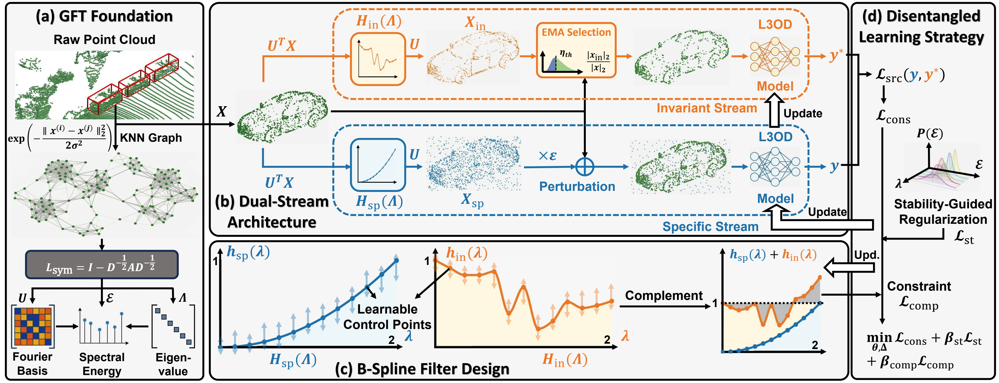

# FIND: Frequency Invariance Disentanglement for Test-Time Adaptation in LiDAR 3D Detection

This is the official project repository for FIND: Frequency Invariance Disentanglement for Test-Time Adaptation in LiDAR 3D Detection by Dongxiao Li, Zixuan Hu and Ling-Yu Duan **(NeurIPS 2026)**.

[](https://arxiv.org/abs/2611.09170)
[](https://huggingface.co/llldx03/FIND)

## Overview

LiDAR-based 3D Object Detection (L3OD) is a fundamental 3D perception task, yet its performance is often compromised by domain shifts arising from diverse sensor configurations and environmental conditions. Existing Test-Time Adaptation (TTA) methods primarily leverage self-supervision in the spatial domain, yet they frequently confound semantic content with domain style due to the sparse, non-Euclidean nature of point clouds. To overcome this limitation, we propose **FIND** (**F**requency **IN**variance **D**isentanglement), a novel TTA framework that precisely disentangles domain-invariant content from domain-specific interference within the frequency domain. Our methodology utilizes B-Spline fitting to construct locally adaptive filters integrated into a dual-stream architecture: an Invariant Stream extracts robust features to guide pseudo-labeling, while a Specific Stream enforces consistency against domain perturbations. By combining invariance-driven alignment with stability-guided regularization, our approach dynamically extracts robust domain-invariant features while suppressing domain-specific interference. Extensive experiments on cross-dataset adaptation and robust corruption benchmarks demonstrate that FIND significantly outperforms state-of-the-art methods.



## Installation

### Requirements

FIND depends on:
  - CUDA Toolkit 11.8
  - Python 3.8
  - PyTorch 1.13.1 + cu117
  - spconv-cu117 2.3.6

Make sure `nvcc` is available on `PATH`.

Run the following commands from the repository root:

```bash
conda env create -f environment.yml
conda activate find
pip install --no-build-isolation --no-binary=torch-cluster torch-cluster==1.6.3
pip install --no-build-isolation --no-deps -e .
```

### Data Preparation

Place or link the datasets under `data/` and run the commands below from the repository root.

**KITTI.** Download [KITTI](https://www.cvlibs.net/datasets/kitti/eval_object.php?obj_benchmark=3d) and place `velodyne/`, `calib/`, `label_2/` and `image_2/` in `data/kitti/training/`. For source training, also place the [road planes](https://github.com/zhuoxiao-chen/MOS#kitti-dataset) in `data/kitti/training/planes/`.

```bash
mkdir -p data/kitti/ImageSets
cp tools/splits/kitti/*.txt data/kitti/ImageSets/
python tools/prepare_data.py kitti
```

**nuScenes.** Download [nuScenes v1.0-trainval](https://www.nuscenes.org/nuscenes) and place `samples/`, `sweeps/`, `maps/` and the metadata folder `v1.0-trainval/` in `data/nuscenes/v1.0-trainval/`.

```bash
python tools/prepare_data.py nuscenes
```

**Waymo.** Download the training TFRecords from the [Waymo Open Dataset](https://waymo.com/open/download/) into `data/waymo/raw_data/`. Use the separate preprocessing environment to convert them, then build the sampling database in the training environment.

```bash
mkdir -p data/waymo/ImageSets
cp tools/splits/waymo/train.txt data/waymo/ImageSets/
conda env create -f waymo-environment.yml
conda activate find-waymo
python tools/prepare_waymo_source.py --raw-root data/waymo --output data/waymo
conda activate find
python tools/make_waymo_database.py --cfg-file tools/cfgs/tta_w2k_models/secondiou/source_pretrain.yaml
```

**KITTI-C.** Download [KITTI-C](https://github.com/ldkong1205/Robo3D) into `data/KITTI-C/<corruption>/<severity>/velodyne/`. Reuse the clean KITTI calibration files and validation metadata:

```bash
ln -s ../kitti/ImageSets data/KITTI-C/ImageSets
ln -s ../kitti/kitti_infos_val.pkl data/KITTI-C/kitti_infos_val.pkl
```

## Get Started

The three SECOND-IoU tasks use the following configuration directories:

| Task | Configuration directory |
| --- | --- |
| nuScenes → KITTI (n2k) | `tools/cfgs/tta_n2k_models/secondiou` |
| Waymo → KITTI (w2k) | `tools/cfgs/tta_w2k_models/secondiou` |
| KITTI → KITTI-C (k2c) | `tools/cfgs/tta_kitti-c_models/secondiou` |

Select a task and its source checkpoint. For example:

```bash
CONFIG=tools/cfgs/tta_n2k_models/secondiou
CKPT=checkpoints/n2k.pth
PRIOR=priors/n2k.pth
```

Download the pretrained checkpoint for your task from [Hugging Face](https://huggingface.co/llldx03/FIND) and place it in `checkpoints/`.

### Source Training

```bash
python tools/train.py --cfg-file $CONFIG/source_pretrain.yaml --output output/source
```

To use a model trained here, set `CKPT` to its file under `output/source/ckpt/`.

### Evaluation

```bash
python tools/test.py --cfg-file $CONFIG/find.yaml --checkpoint $CKPT --output output/test
```

### Test-Time Adaptation

Prepare source spectral statistics once, then adapt to the target stream:

```bash
python tools/find.py source-prior --cfg-file $CONFIG/find.yaml --checkpoint $CKPT --output $PRIOR
python tools/find.py online --cfg-file $CONFIG/find.yaml --checkpoint $CKPT --prior $PRIOR --output output/find --evaluate
```

For KITTI-C, set `DATA_CONFIG_TAR.CORRUPT` in `find.yaml` (e.g. `snow/heavy`) and start a fresh run for each condition. Use a separate output directory for each run.

## Correspondence

Please contact Dongxiao Li by [dxli25@stu.pku.edu.cn] if you have any questions. 📬

## Acknowledgement

This repository is built using the [MOS](https://github.com/zhuoxiao-chen/MOS) and [OpenPCDet](https://github.com/open-mmlab/OpenPCDet) repository. Thanks for these excellent projects!

## Citation

```bibtex
@article{li2026find,
  title={{FIND}: Frequency Invariance Disentanglement for Test-Time Adaptation in {LiDAR} {3D} Detection},
  author={Li, Dongxiao and Hu, Zixuan and Duan, Ling-Yu},
  journal={arXiv preprint arXiv:2611.09170},
  year={2026}
}
```
